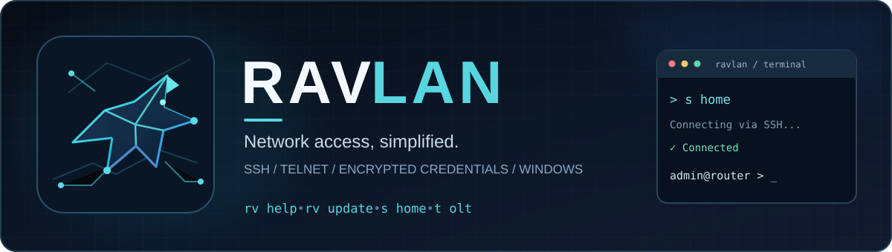

<div align="center">



# RAVLAN

### Fast, secure-by-default device access for Windows

**One command. Your devices. Your terminal.**

A lightweight Windows CLI for network administrators. Connect over **SSH or Telnet**, save device aliases, and launch sessions directly from **Win + R** — without repeatedly entering credentials.

[](https://github.com/karen101996/ravlan-releases/releases/latest)
[](#requirements)
[](#requirements)
[](https://github.com/karen101996/ravlan-releases/actions/workflows/publish-release.yml)

### [Download latest release](https://github.com/karen101996/ravlan-releases/releases/latest) · [Quick start](#quick-start) · [Command reference](#command-reference) · [Русский](#русский) · [O‘zbekcha](#ozbekcha)

</div>

---

## Why RAVLAN?

Managing routers, switches, OLTs and other network devices often means remembering IP addresses, opening terminal sessions, and typing the same passwords again. RAVLAN makes the everyday workflow shorter.

```text
Win + R  →  home  →  SSH session
Win + R  →  olt   →  Telnet session

CMD> s home
CMD> t olt
CMD> rv help
```

### Features

| | Capability | Details |
|:--:|---|---|
| 🔐 | **SSH & Telnet** | Interactive CLI sessions with simple `s` and `t` commands |
| 🗝️ | **Encrypted credentials** | Saved passwords protected locally using Windows DPAPI |
| ⚡ | **Win + R shortcuts** | Open a saved device directly by its alias |
| 📒 | **Device address book** | Add, list and search devices by name or IP |
| 👤 | **SSH login management** | Default username `admin`; customize or edit per device |
| 🔄 | **Password reset** | Replace saved SSH or Telnet passwords with `--reset` |
| 🌐 | **Three languages** | Russian, English and Uzbek help interface |
| 📦 | **Easy updates** | Run `rv update` to install a verified public release |

> [!IMPORTANT]
> **SSH and Telnet are different protocols.** SSH encrypts network traffic and verifies server host keys. Telnet does **not** encrypt traffic: use it only on trusted management networks.

## Quick start

### Requirements

- **Windows 10 or Windows 11**
- Internet access for initial setup and updates
- Network access to your equipment (typically SSH TCP **22** or Telnet TCP **23**)
- Python **3.10+**; the installer can set up a compatible Python version when needed

### Installation

1. Open **[Latest release](https://github.com/karen101996/ravlan-releases/releases/latest)** and download the `RAVLAN-*-Windows.zip` archive under **Assets**.
2. Extract the archive into a folder.
3. Run **`INSTALL.bat`**.
4. Open a **new** CMD or Windows Terminal window.
5. Check installation and connect:

```bat
rv version
rv help
s 192.168.88.1
```

RAVLAN installs under `%LOCALAPPDATA%\RAVLAN` and adds launchers to `%USERPROFILE%\bin`. Administrator rights are not normally required. Initial setup may install Python and Python dependencies.

### Your first saved device

```bat
s add home 192.168.88.1
s home
```

The SSH username defaults to **`admin`**. On first login, enter the SSH password. After successful authentication, RAVLAN saves it encrypted for future connections. When an SSH server is new, confirm its host-key fingerprint **only after verifying it belongs to your device**.

To use a different username:

```bat
s add router 192.168.88.2 operator
s edit router admin
```

To create a Telnet shortcut:

```bat
t add olt 192.168.1.10
t olt
```

You can also press **Win + R**, enter `home`, `router` or `olt`, and connect using the saved device protocol.

## Command reference

| Command | Purpose |
|---|---|
| `s IP` | SSH connection (port 22, username `admin` by default) |
| `s IP 2222 --user LOGIN` | SSH with custom port and username |
| `t IP` | Telnet connection (port 23) |
| `t IP 2323` | Telnet with a custom port |
| `s add NAME IP [LOGIN]` | Save an SSH device; login defaults to `admin` |
| `t add NAME IP` | Save a Telnet device |
| `s edit NAME LOGIN` | Change the username of a saved SSH device |
| `s NAME` / `t NAME` | Connect using a saved alias |
| `s list` / `t list` | List saved devices |
| `s search QUERY` / `t search QUERY` | Search by alias or IP |
| `s NAME --reset` | Clear the saved SSH password and enter a new one |
| `t NAME --reset` | Reset saved Telnet credentials |
| `rv help` | Show interactive, localized command help |
| `rv language ru\|en\|uz` | Change help language |
| `rv version` | Display installed version |
| `rv update` | Check for and install updates |

### Everyday examples

```bat
s add mikrotik 192.168.88.1 admin
s mikrotik
s mikrotik --reset

t add switch 192.168.1.20
t switch

rv language ru
rv help
rv update
```

## Security & privacy

RAVLAN keeps saved settings **on your Windows PC**.

- **SSH passwords:** `%USERPROFILE%\TelnetManager\ssh_passwords.json`
- **Telnet credentials:** `%USERPROFILE%\TelnetManager\credentials.json`
- **Device aliases:** `%USERPROFILE%\TelnetManager\devices.json`
- **SSH usernames:** `%USERPROFILE%\TelnetManager\ssh_users.json`
- **SSH known hosts:** `%USERPROFILE%\TelnetManager\ssh_known_hosts`
- **Encryption:** Windows DPAPI protects stored passwords for the Windows user context.
- **SSH host-key checks:** Unknown host keys require confirmation; changed trusted host keys are not silently accepted.
- **No credential cloud sync:** Device passwords are not uploaded to GitHub.
- **Release integrity:** The updater validates downloaded files against Git blob SHA-1 values in [`version.json`](version.json). This is an integrity check, **not** a signed release or a guarantee against repository compromise.

> [!WARNING]
> DPAPI protects passwords **at rest**, not from programs already running with access to your Windows user account. Telnet traffic remains unencrypted, including authentication. Prefer SSH whenever your equipment supports it.

## Updates and releases

Run:

```bat
rv update
```

RAVLAN checks for updates periodically and can install a newer release on request. Existing device aliases and saved credentials are preserved by normal updates.

- **[Latest stable release](https://github.com/karen101996/ravlan-releases/releases/latest)**
- [All releases](https://github.com/karen101996/ravlan-releases/releases)
- [Changelog](CHANGELOG.md)
- [Release manifest](version.json)

## Troubleshooting

<details>
<summary><strong>Windows says `s`, `t` or `rv` is not recognized</strong></summary>

Open a new terminal after installation. Check `where s`, `where t` and `where rv`. RAVLAN places its command launchers in `%USERPROFILE%\bin`.

</details>

<details>
<summary><strong>SSH asks for the password again</strong></summary>

The password is saved only after a successful SSH authentication. Verify the username and target device. To replace a saved password, use `s NAME --reset`.

</details>

<details>
<summary><strong>SSH connection refused or timed out</strong></summary>

Confirm the IP address, network route, SSH service and port on the device. RAVLAN cannot enable SSH remotely on equipment where it is disabled.

</details>

<details>
<summary><strong>The SSH host-key fingerprint is unfamiliar</strong></summary>

Verify the fingerprint through a trusted management channel before accepting it. Do not blindly approve unexpected key changes.

</details>

<details>
<summary><strong>How do I change the language?</strong></summary>

Run `rv language ru`, `rv language en` or `rv language uz`. The setting persists across launches.

</details>

## Project

[Roadmap](ROADMAP.md) · [Changelog](CHANGELOG.md) · [Security policy](SECURITY.md) · [Contributing](CONTRIBUTING.md) · [Report an issue](https://github.com/karen101996/ravlan-releases/issues)

---

## Русский

### RAVLAN — быстрый доступ к сетевому оборудованию через SSH и Telnet

**RAVLAN** — бесплатная утилита командной строки для Windows 10 и 11. Она помогает администраторам подключаться к маршрутизаторам, коммутаторам, OLT и другому сетевому оборудованию без постоянного ввода IP-адресов, логинов и паролей.

**Один раз добавил устройство — дальше подключаешься по короткому имени.** Можно запускать из CMD, Windows Terminal или прямо через **Win + R**.

```text
Win + R → home → подключение по SSH
Win + R → olt  → подключение по Telnet

CMD> s home
CMD> t olt
```

### Возможности

| Функция | Что это даёт |
|---|---|
| **SSH и Telnet** | Работа с командной строкой сетевого оборудования |
| **Быстрые имена** | Вместо IP-адреса достаточно команды `s home` или `t olt` |
| **Win + R** | Запуск сохранённого подключения без предварительного открытия терминала |
| **Сохранение паролей** | Пароли сохраняются локально и шифруются средствами Windows DPAPI |
| **Автоматический вход** | После успешной первой авторизации не нужно каждый раз вводить пароль |
| **Адресная книга** | Добавление, поиск и просмотр сохранённых устройств |
| **Управление логином SSH** | Логин по умолчанию `admin`, можно указать свой |
| **Смена пароля** | Команда `--reset` запрашивает и сохраняет новый пароль |
| **Проверка SSH-ключа** | Подтверждение ключа нового SSH-сервера и контроль изменений |
| **Три языка** | Русский, английский и узбекский интерфейс справки |
| **Обновления** | Установка новой версии командой `rv update` |

### Установка на Windows

1. Перейди на страницу **[последнего релиза RAVLAN](https://github.com/karen101996/ravlan-releases/releases/latest)**.
2. В разделе **Assets** скачай ZIP-архив RAVLAN для Windows.
3. Распакуй архив в удобную папку.
4. Запусти **`INSTALL.bat`** и дождись окончания установки.
5. Открой **новое окно CMD** или Windows Terminal.
6. Проверь версию и открой справку:

```bat
rv version
rv language ru
rv help
```

Программа устанавливается в `%LOCALAPPDATA%\RAVLAN`, а команды запуска добавляются в `%USERPROFILE%\bin`. Обычно права администратора не требуются. При первой установке может понадобиться доступ к интернету для Python и зависимостей.

### Быстрый старт: SSH

Подключиться к устройству по IP:

```bat
s 192.168.88.1
```

По умолчанию RAVLAN использует порт **22** и имя пользователя **admin**. При первом подключении нужно подтвердить ключ SSH-сервера, предварительно проверив его отпечаток, и ввести пароль. После успешной авторизации пароль сохраняется в зашифрованном виде.

Создать короткое имя и подключиться:

```bat
s add home 192.168.88.1
s home
```

Добавить устройство с другим логином или изменить существующий:

```bat
s add office 192.168.88.2 operator
s edit office admin
s office
```

Если пароль на устройстве поменялся, сбросить старый:

```bat
s home --reset
```

RAVLAN запросит новый пароль и сохранит его **только после успешного входа**. Пароли остальных устройств не изменятся.

### Быстрый старт: Telnet

```bat
t 192.168.1.10
t add olt 192.168.1.10
t olt
t olt --reset
```

Для Telnet стандартный порт — **23**. При необходимости можно указать нестандартный порт:

```bat
t 192.168.1.10 2323
```

### Запуск через Win + R

После добавления устройства под именем `home` или `olt`:

1. Нажми **Win + R**.
2. Введи `home` или `olt`.
3. Нажми **Enter** — откроется подключение по сохранённому протоколу.

Это удобно, если приходится часто заходить на одно и то же оборудование.

### Справочник команд

| Команда | Назначение |
|---|---|
| `s IP` | Подключиться по SSH |
| `s IP 2222 --user LOGIN` | SSH с другим портом и логином |
| `t IP` | Подключиться по Telnet |
| `t IP 2323` | Telnet с другим портом |
| `s add ИМЯ IP [ЛОГИН]` | Добавить SSH-устройство |
| `t add ИМЯ IP` | Добавить Telnet-устройство |
| `s edit ИМЯ ЛОГИН` | Изменить логин SSH |
| `s ИМЯ` / `t ИМЯ` | Подключиться по сохранённому имени |
| `s list` / `t list` | Показать устройства |
| `s search ТЕКСТ` / `t search ТЕКСТ` | Найти устройство |
| `s ИМЯ --reset` | Заменить сохранённый пароль SSH |
| `t ИМЯ --reset` | Сбросить данные Telnet |
| `rv help` | Справка по командам |
| `rv language ru` | Русский язык справки |
| `rv language en` | Английский язык справки |
| `rv language uz` | Узбекский язык справки |
| `rv version` | Посмотреть установленную версию |
| `rv update` | Проверить и установить обновление |

### Безопасность и конфиденциальность

- Пароли хранятся **локально на компьютере** и шифруются через **Windows DPAPI**.
- SSH обеспечивает шифрование сетевого соединения; при первом подключении важно проверить отпечаток ключа сервера.
- **Telnet не шифрует трафик**. Даже если пароль защищён на диске, при подключении через Telnet он передаётся по сети без шифрования. Используй Telnet только в доверенных сетях управления.
- RAVLAN не синхронизирует сохранённые пароли с GitHub.
- Обновления загружаются через HTTPS с проверкой файлов по опубликованному манифесту. Это **не цифровая подпись релиза**.

Подробнее: [Политика безопасности](SECURITY.md).

### Частые вопросы

<details>
<summary><strong>Команда s, t или rv не запускается — что делать?</strong></summary>

После установки закрой и заново открой CMD. Проверь `where s`, `where t` и `where rv`. Команды должны находиться в `%USERPROFILE%\bin`.

</details>

<details>
<summary><strong>Как изменить пароль SSH после смены пароля на устройстве?</strong></summary>

Выполни `s ИМЯ --reset`. После успешного подключения новый пароль будет сохранён автоматически.

</details>

<details>
<summary><strong>Можно ли использовать разные логины на разных устройствах?</strong></summary>

Да. Укажи логин при добавлении: `s add office 192.168.1.1 operator`. Для изменения используй `s edit office admin`.

</details>

<details>
<summary><strong>Обновление удалит сохранённые устройства и пароли?</strong></summary>

Обычное обновление через `rv update` сохраняет адресную книгу и существующие зашифрованные учётные данные.

</details>

<details>
<summary><strong>Можно ли использовать RAVLAN без интернета?</strong></summary>

После установки для подключения к оборудованию достаточно сетевого доступа к самому устройству. Интернет нужен для установки зависимостей и проверки обновлений.

</details>

### Полезные ссылки

**[Скачать RAVLAN](https://github.com/karen101996/ravlan-releases/releases/latest)** · [История версий](CHANGELOG.md) · [Планы развития](ROADMAP.md) · [Сообщить об ошибке](https://github.com/karen101996/ravlan-releases/issues)


---

## O‘zbekcha

### RAVLAN — Windows uchun SSH va Telnet orqali tezkor ulanish

**RAVLAN** — Windows 10 va Windows 11 tizimlarida router, kommutator, OLT va boshqa tarmoq qurilmalarini boshqarish uchun qulay buyruqlar qatori dasturi.

Qurilmaning IP manzilini har safar yozish shart emas: uni bir marta qisqa nom bilan saqlang va keyin **CMD**, **Windows Terminal** yoki **Win + R** orqali ulaning.

```text
Win + R → home → SSH orqali ulanish
Win + R → olt  → Telnet orqali ulanish

CMD> s home
CMD> t olt
```

### Asosiy imkoniyatlar

| Imkoniyat | Tavsif |
|---|---|
| **SSH va Telnet** | Tarmoq qurilmalarining buyruqlar qatoriga ulanish |
| **Qisqa nomlar** | IP o‘rniga `s home` yoki `t olt` buyrug‘idan foydalanish |
| **Win + R** | Saqlangan qurilmaga tezkor ulanish |
| **Parollarni saqlash** | Windows DPAPI yordamida mahalliy shifrlash |
| **Avtomatik kirish** | Muvaffaqiyatli birinchi ulanishdan keyin parolni qayta kiritmaslik |
| **Qurilmalar ro‘yxati** | Qurilmalarni qo‘shish, ko‘rish va qidirish |
| **SSH foydalanuvchisi** | Standart login — `admin`; uni o‘zgartirish mumkin |
| **Parolni yangilash** | `--reset` orqali eski parolni almashtirish |
| **SSH server kaliti** | Noma’lum server kalitini tekshirish va tasdiqlash |
| **Uchta til** | O‘zbek, rus va ingliz tillaridagi yordam menyusi |
| **Yangilanishlar** | `rv update` orqali dasturni yangilash |

### O‘rnatish

1. **[RAVLAN’ning so‘nggi versiyasi](https://github.com/karen101996/ravlan-releases/releases/latest)** sahifasini oching.
2. **Assets** bo‘limidan Windows uchun ZIP arxivini yuklab oling.
3. Arxivni alohida papkaga oching.
4. **`INSTALL.bat`** faylini ishga tushiring.
5. O‘rnatish tugagach, yangi CMD yoki Windows Terminal oynasini oching.
6. Versiyani tekshiring va o‘zbek tilini tanlang:

```bat
rv version
rv language uz
rv help
```

Dastur odatda `%LOCALAPPDATA%\RAVLAN` papkasiga o‘rnatiladi. Dastlabki o‘rnatishda Python va kerakli kutubxonalarni yuklab olish uchun internet kerak bo‘lishi mumkin.

### SSH orqali ulanish

IP manzil bilan ulanish:

```bat
s 192.168.88.1
```

Standart SSH porti — **22**, foydalanuvchi nomi esa **admin**. Birinchi ulanishda server kalitining haqiqiyligini tekshirib, parolni kiriting. Muvaffaqiyatli kirishdan so‘ng parol Windows DPAPI orqali shifrlangan holda saqlanadi.

Qurilmani nom bilan saqlash:

```bat
s add home 192.168.88.1
s home
```

Boshqa loginni ko‘rsatish yoki o‘zgartirish:

```bat
s add office 192.168.88.2 operator
s edit office admin
s office
```

SSH paroli o‘zgargan bo‘lsa:

```bat
s home --reset
```

Yangi parol faqat **muvaffaqiyatli autentifikatsiyadan keyin** saqlanadi. Boshqa qurilmalarning parollari o‘zgarmaydi.

### Telnet orqali ulanish

```bat
t 192.168.1.10
t add olt 192.168.1.10
t olt
t olt --reset
```

Telnet uchun standart port — **23**. Boshqa portni ko‘rsatish mumkin:

```bat
t 192.168.1.10 2323
```

### Win + R orqali tezkor ulanish

1. Qurilmani `home` yoki `olt` nomi bilan saqlang.
2. Klaviaturada **Win + R** tugmalarini bosing.
3. Qurilma nomini kiriting va **Enter** tugmasini bosing.

RAVLAN saqlangan protokol orqali ulanish oynasini ochadi.

### Buyruqlar jadvali

| Buyruq | Vazifasi |
|---|---|
| `s IP` | SSH orqali ulanish |
| `s IP 2222 --user LOGIN` | Boshqa port va login bilan SSH |
| `t IP` | Telnet orqali ulanish |
| `t IP 2323` | Boshqa port bilan Telnet |
| `s add NOM IP [LOGIN]` | SSH qurilmasini qo‘shish |
| `t add NOM IP` | Telnet qurilmasini qo‘shish |
| `s edit NOM LOGIN` | SSH loginini o‘zgartirish |
| `s NOM` / `t NOM` | Saqlangan nom orqali ulanish |
| `s list` / `t list` | Qurilmalar ro‘yxati |
| `s search MATN` / `t search MATN` | Qurilmani qidirish |
| `s NOM --reset` | SSH parolini yangilash |
| `t NOM --reset` | Telnet ma’lumotlarini qayta kiritish |
| `rv help` | Yordam menyusi |
| `rv language uz` | O‘zbek tilini tanlash |
| `rv language ru` | Rus tilini tanlash |
| `rv language en` | Ingliz tilini tanlash |
| `rv version` | O‘rnatilgan versiyani ko‘rish |
| `rv update` | Yangilanishni tekshirish va o‘rnatish |

*Eslatma:* `NOM`, `IP`, `LOGIN` va `MATN` — tushuntirish uchun yozilgan belgilar. Buyruqda ularning o‘rniga haqiqiy qiymatlarni kiriting.

### Xavfsizlik

- Saqlangan parollar kompyuterning o‘zida **Windows DPAPI** yordamida shifrlanadi.
- **SSH** tarmoq orqali uzatiladigan ma’lumotlarni shifrlaydi. Yangi SSH server kalitini tasdiqlashdan oldin uning haqiqiyligini tekshiring.
- **Telnet** tarmoq trafikini shifrlamaydi. Uni faqat ishonchli boshqaruv tarmoqlarida ishlating.
- RAVLAN saqlangan qurilma parollarini GitHub’ga yubormaydi.
- Yangilanish fayllari ochiq versiya manifestidagi xesh qiymatlari bilan tekshiriladi. Bu raqamli imzo o‘rnini bosmaydi.

Batafsil: [Xavfsizlik siyosati](SECURITY.md).

### Ko‘p beriladigan savollar

<details>
<summary><strong>s, t yoki rv buyrug‘i ishlamasa nima qilish kerak?</strong></summary>

O‘rnatishdan keyin CMD oynasini yopib, yangisini oching. `where s`, `where t` va `where rv` buyruqlari bilan tekshiring.

</details>

<details>
<summary><strong>SSH parolini qanday almashtirish mumkin?</strong></summary>

`s NOM --reset` buyrug‘ini kiriting. Yangi parol muvaffaqiyatli ulanishdan so‘ng saqlanadi.

</details>

<details>
<summary><strong>Har bir qurilma uchun alohida login ishlatsa bo‘ladimi?</strong></summary>

Ha. Masalan, `s add office 192.168.1.1 operator`. Keyin loginni `s edit office admin` orqali o‘zgartirishingiz mumkin.

</details>

<details>
<summary><strong>Yangilash saqlangan qurilmalarni o‘chiradimi?</strong></summary>

Odatdagi `rv update` yangilanishi qurilmalar ro‘yxati va shifrlangan parollarni saqlab qoladi.

</details>

### Havolalar

**[RAVLAN’ni yuklab olish](https://github.com/karen101996/ravlan-releases/releases/latest)** · [Versiyalar tarixi](CHANGELOG.md) · [Rivojlanish rejasi](ROADMAP.md) · [Xatolik haqida xabar berish](https://github.com/karen101996/ravlan-releases/issues)

---

<div align="center">

**RAVLAN — less typing, faster access.**

[Download latest release](https://github.com/karen101996/ravlan-releases/releases/latest) · [Report a bug](https://github.com/karen101996/ravlan-releases/issues) · [Release history](CHANGELOG.md)

</div>


> **Upgrade compatibility:** Existing installations retain their original application and `%USERPROFILE%\TelnetManager` data directories to preserve encrypted credentials and shortcuts. The previous `np` command remains available for compatibility; use `rv` for new instructions.
